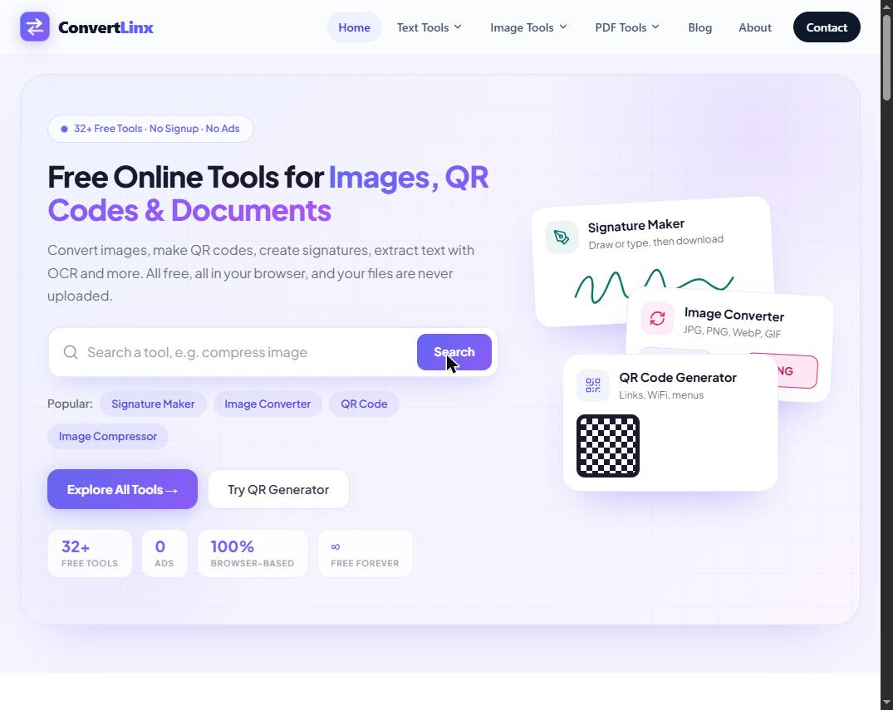

# ConvertLinx – Free Online Converter & Utility Tools

[](https://convertlinx.com)
[](https://nextjs.org)
[](https://tailwindcss.com)

[ConvertLinx](https://convertlinx.com) is a free online toolkit. Convert images, audio and video, generate files, and use handy text and developer utilities in your browser with no signup and no watermark.



🌐 **Website:** [https://convertlinx.com](https://convertlinx.com)

## Image Tools

- [Image Compressor](https://convertlinx.com/image-compressor)
- [Image Converter](https://convertlinx.com/image-converter)
- [Image Resizer](https://convertlinx.com/image-resizer)
- [Image Cropper](https://convertlinx.com/image-cropper)
- [Rotate & Flip Image](https://convertlinx.com/rotate-flip-image)
- [Background Remover](https://convertlinx.com/background-remover)
- [PNG to JPG](https://convertlinx.com/png-to-jpg)
- [PNG to ICO](https://convertlinx.com/png-to-ico)
- [JFIF to JPG](https://convertlinx.com/jfif-to-jpg)
- [HEIC to JPG](https://convertlinx.com/heic-to-jpg)
- [Image to Text (OCR)](https://convertlinx.com/image-to-text)
- [Add Watermark](https://convertlinx.com/add-watermark)
- [Signature Maker](https://convertlinx.com/signature-maker)
- [Favicon Generator](https://convertlinx.com/favicon-generator)
- [YouTube Thumbnail Downloader](https://convertlinx.com/youtube-thumbnail)

## Audio & Video Tools

- [Audio Converter](https://convertlinx.com/audio-converter)
- [MP4 to MP3](https://convertlinx.com/mp4-to-mp3)
- [Video Compressor](https://convertlinx.com/video-compressor)

## Text & Document Tools

- [Text to PDF](https://convertlinx.com/text-to-pdf)
- [Text to Speech](https://convertlinx.com/text-to-speech)
- [Word Counter](https://convertlinx.com/word-counter)
- [Case Converter](https://convertlinx.com/case-converter)
- [Text to Slug](https://convertlinx.com/text-to-slug)
- [Lorem Ipsum Generator](https://convertlinx.com/lorem-ipsum)

## Developer & Design Tools

- [JSON Formatter](https://convertlinx.com/json-formatter)
- [Base64 Encoder / Decoder](https://convertlinx.com/base64-tool)
- [Regex Tester](https://convertlinx.com/regex-tester)
- [Color Picker](https://convertlinx.com/color-picker)
- [Color Palette Generator](https://convertlinx.com/color-palette-generator)

## SEO & Web Tools

- [Meta Tag Generator](https://convertlinx.com/metatag-generator)
- [Open Graph Preview Checker](https://convertlinx.com/og-preview-checker)
- [WhatsApp Link Generator](https://convertlinx.com/whatsapp-link-generator)

## Generators & Converters

- [QR Code Generator](https://convertlinx.com/qr-generator)
- [Password Generator](https://convertlinx.com/password-gen)
- [Unit Converter](https://convertlinx.com/unit-converter)

👉 See all tools at [convertlinx.com](https://convertlinx.com)

## Features

- ✅ 100% free, no account needed
- ✅ No watermark on output files
- ✅ Fast, works on mobile and desktop
- ✅ Runs in your browser, your files stay on your device

## Run Locally

```bash
git clone https://github.com/ashfaqazad/convertlinx.git
cd convertlinx
npm install
npm run dev
```

Then open http://localhost:3000.

## Tech Stack

Next.js, Tailwind CSS, Framer Motion

## Support

If you find this project useful, please give it a ⭐ on GitHub.

## Author

Built by [Ashfaque Azad](https://ashfaqdev.cloud)
